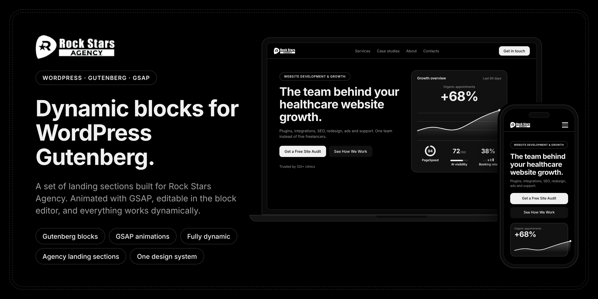

<p align="center">
  
</p>

<p align="center">
  <a href="#about-the-project">About</a> •
  <a href="#key-features">Key Features</a> •
  <a href="#performance-metrics">Metrics</a> •
  <a href="#design-system">Design System</a> •
  <a href="#landing-sections">Sections</a> •
  <a href="#quick-start">Quick Start</a> •
  <a href="#github-pages-deployment">Deployment</a>
</p>

---

## 🌟 Dynamic blocks for WordPress Gutenberg

> **A set of landing sections built for Rock Stars Agency.**  
> Animated with **GSAP**, editable in the block editor, and everything works dynamically.

A high-performance, modular healthcare website development & growth landing page. Built to replace fragmented freelancer workflows with a single unified technical partner — covering plugins, custom development, integrations, GEO/SEO, and performance care.

---

## 🚀 Key Features

| Badge | Capability | Description |
| :--- | :--- | :--- |
| **Gutenberg blocks** | Native & Modular | Modular section architecture ready for Gutenberg block decomposition. |
| **GSAP animations** | High-Framerate FX | Stacking pinned cards, SVG motion paths, and interactive carousels. |
| **Fully dynamic** | Reactive UI | Live FAQ accordions, hover transitions, and responsive controls. |
| **Agency landing sections** | 14 Tailored Sections | Complete conversion funnel engineered specifically for medical & healthcare growth. |
| **One design system** | Strict Token System | 5-color dark palette, signature double-dashed borders, unified radii. |

---

## 📊 Performance & Growth Metrics

Captured directly from our live client deployments:

- 📈 **+68% Organic Appointments** — Consistent steady growth over 90-day cycles.
- ⚡ **94 PageSpeed Score** — High Core Web Vitals score on mobile and desktop.
- 🤖 **72/100 AI Visibility** — Generative Engine Optimization (GEO) for ChatGPT, Perplexity, and AI Overviews.
- 🎯 **38% Booking Rate** — High-intent conversion funnel optimization.
- 🏥 **Trusted by 120+ Clinics** — Medical practices, dental surgery teams, and healthcare platforms.

---

## 🎨 Design System Standards

The project strictly follows the **Rock Stars Agency Design System**:

### 1. Color Palette (5 tokens only)
```css
--color-bg-base:      #000000; /* Page root background */
--color-bg-surface:   #111111; /* Cards, panels, active card body */
--color-border-line:  #2A2A2A; /* Dashed/solid structural borders */
--color-text-primary: #F0F0F0; /* Headings, primary text, active borders */
--color-text-muted:   #A0A0A0; /* Subtitles, labels, descriptions */
```

### 2. Signature Double Dashed Border
A signature visual language across cards and accordions:
- **Outer border:** `1px dashed #2A2A2A` with `20px` border radius
- **Channel gap:** `4px` black boundary separation
- **Inner border:** `1px dashed #2A2A2A` with `16px` border radius (fades to transparent on active/hover)
- **Active state:** Smooth single solid white border (`1px solid #F0F0F0`) with zero layout shift.

---

## 📑 Landing Sections & Architecture

The landing page is decomposed into **14 modular sections**, each with its own isolated CSS stylesheet and standalone preview:

| # | Section Name | ID | Section File | Modular CSS | Standalone Preview |
| :-: | :--- | :--- | :--- | :--- | :--- |
| **01** | **Hero** | `#hero` | `01-hero.html` | `css/hero-section.css` | `previews/01-hero.html` |
| **02** | **Trust & Proof** | `#trust` | `02-trust.html` | `css/trust-section.css` | `previews/02-trust.html` |
| **03** | **Problem** | `#problem` | `03-problem.html` | `css/problem-section.css` | `previews/03-problem.html` |
| **04** | **Services / Capabilities** | `#services` | `04-services.html` | `css/services-section.css` | `previews/04-services.html` |
| **05** | **Development & Plugins** | `#development` | `05-dev.html` | `css/dev-section.css` | `previews/05-dev.html` |
| **06** | **Integrations & Pipelines**| `#integrations` | `06-integrations.html` | `css/integrations-section.css`| `previews/06-integrations.html` |
| **07** | **SEO & Core Web Vitals** | `#seo` | `07-seo.html` | `css/seo-section.css` | `previews/07-seo.html` |
| **08** | **GEO (Generative Engine)** | `#geo` | `08-geo.html` | `css/geo-section.css` | `previews/08-geo.html` |
| **10** | **Growth, Ads & Analytics** | `#growth` | `10-growth.html` | `css/growth-section.css` | `previews/10-growth.html` |
| **12** | **Process (How We Work)** | `#how-we-work` | `12-process.html` | `css/process-section.css` | `previews/12-process.html` |
| **13** | **Results & Testimonials** | `#results` | `13-results.html` | `css/results-section.css` | `previews/13-results.html` |
| **14** | **Formats & Pricing** | `#formats` | `14-formats.html` | `css/formats-section.css` | `previews/14-formats.html` |
| **15** | **FAQ Accordion** | `#faq` | `15-faq.html` | `css/faq-section.css` | `previews/15-faq.html` |
| **16** | **Articles Stacking Slider**| `#articles` | `16-articles.html` | `css/articles-slider.css` | `previews/16-articles.html` |

---

## 📂 Project Structure

```text
├── README.md                      # Project documentation with GitHub banner
├── index.html                     # Root redirect for GitHub Pages
└── html-dev/                      # Production application root
    ├── index.html                 # Assembled master landing page
    ├── template.html              # Clean base skeleton (<head>, <main>, scripts)
    ├── build.js                   # Instant build script (merges sections & generates previews)
    ├── server.js                  # Local dev server with live auto-watch rebuilding
    ├── package.json               # NPM scripts (npm start, npm run build)
    ├── github-baners/             # Brand presentation assets & banners
    │   └── Rock_Stars_GitHub_Banner.png
    ├── sections/                  # Clean source code for each individual section
    │   ├── 01-hero.html
    │   ├── ...
    │   └── 16-articles.html
    ├── previews/                  # Autonomous preview pages with sticky nav toolbar
    │   ├── 01-hero.html
    │   ├── ...
    │   └── 16-articles.html
    ├── css/                       # Modular CSS stylesheets (14 sections + base tokens)
    │   ├── variables.css          # Design system color & typography tokens
    │   ├── base.css               # Reset, typography, section badge styling
    │   ├── style.css              # Master bundle with @import cascade
    │   └── *-section.css          # Individual CSS per section
    ├── js/                        # JavaScript controllers & GSAP animation scripts
    └── img/                       # Optimized web images, partner logos, and team photos
```

---

## ⚡ Quick Start

### 1. Start Development Server
```bash
cd html-dev
npm start
# or: node server.js
```
The local server will start on [http://localhost:3000/](http://localhost:3000/):
- **Full Landing Page:** `http://localhost:3000/`
- **Sections Directory:** `http://localhost:3000/previews`
- **Direct Section Preview:** `http://localhost:3000/previews/14-formats.html`

### 2. Auto-Rebuilding Watcher
Any modification inside `html-dev/sections/*.html` or `html-dev/template.html` automatically rebuilds both `html-dev/index.html` and the respective preview in under **10ms**.

### 3. Manual Static Build
```bash
cd html-dev
npm run build
# or: node build.js
```

---

## 🌐 GitHub Pages Deployment

The repository is pre-configured for static deployment on **GitHub Pages**:
1. Push this repository to GitHub.
2. In your repository settings: **Settings → Pages → Build and deployment → Branch: `main`, Folder: `/ (root)`**.
3. The root `index.html` immediately routes visitors to `html-dev/index.html`.
4. All section previews (`previews/*.html`) work independently without needing a Node.js server.

---

<p align="center">
  
</p>

<p align="center">
  <b>Built for Rock Stars Agency</b><br>
  <sub>Website Development & Growth for Healthcare Platforms</sub>
</p>

